<p align="center">
  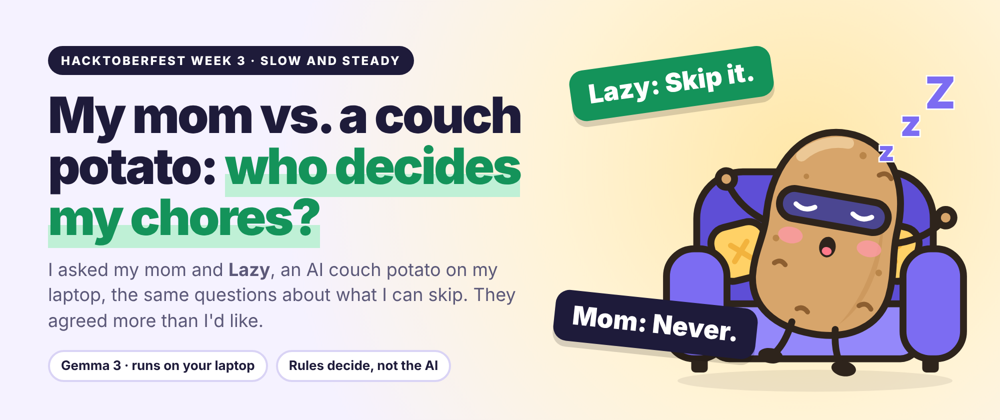
</p>

<h1 align="center">Do I Need to Do This?</h1>

<p align="center">
  <a href="https://github.com/Raga-V/do-i-need-to-do-this/actions/workflows/deploy.yml"></a>
  
  
  
</p>

<p align="center">
  <b>Tell it what you're avoiding. Gemma 3 asks a few questions on your laptop. Plain rules give an honest verdict.</b><br>
  <a href="https://raga-v.github.io/do-i-need-to-do-this/"><b>Try it live</b></a> · <a href="#run-it">Run it</a> · <a href="#how-it-decides">How it decides</a> · <a href="#privacy">Privacy</a> · <a href="#partner-technologies">Partners</a>
</p>

---

Type the task you're avoiding: *"Go to the 8 AM lecture tomorrow"*, *"Pay the electricity bill"*. Optionally add a line of context or a photo of a timetable, notice or screenshot. **Gemma 3 runs on your own laptop**, asks up to three tap-to-answer questions, and then the app hands down one of five verdicts.

<p align="center">
  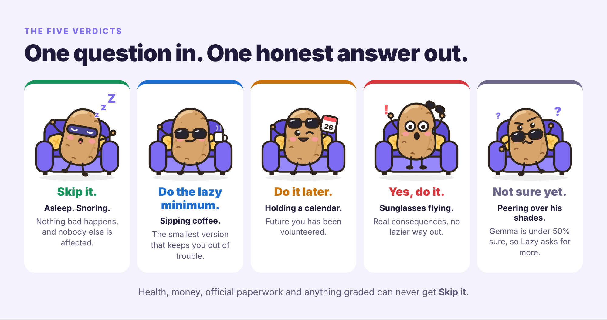
</p>

Built for the DEV Hacktoberfest Open-Source AI Challenge, Week 3: *Slow and Steady* (build something with open-source AI that rewards laziness).

## Meet Lazy

<table align="center">
  <tr>
    <td align="center"><br><sub><b>Home</b><br>chilling</sub></td>
    <td align="center"><br><sub><b>Thinking</b><br>while Gemma works</sub></td>
    <td align="center"><br><sub><b>Skip it</b><br>asleep</sub></td>
    <td align="center"><br><sub><b>Lazy minimum</b><br>coffee</sub></td>
    <td align="center"><br><sub><b>Later</b><br>calendar</sub></td>
    <td align="center"><br><sub><b>Yes, do it</b><br>jumping</sub></td>
    <td align="center"><br><sub><b>Not sure</b><br>puzzled</sub></td>
  </tr>
</table>

**Lazy** is a couch potato in sunglasses, drawn entirely in code ([`public/mascot.js`](public/mascot.js), no image files in the app). Lazy chills on the couch on the home screen, thinks hard while Gemma works (with a rotating status line: *"Lazy is consulting the couch…"*, *"Weighing your excuses…"*), and pops in with a mood that matches the ruling. A small version of Lazy's face is the logo and the browser-tab icon, and shows up in notes like "Lazy learned…" and "Lazy can't reach Gemma yet". Animations switch off under `prefers-reduced-motion`.

**Lazy never changes a verdict.** The rules below do.

### How it feels

<p align="center">
  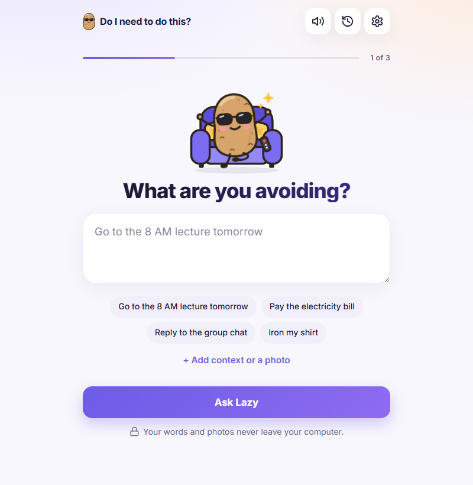
</p>

One calm, light, single-column flow (max 560px, built mobile-first and checked at 375px):

1. **What are you avoiding?** One big text box, example chips, and an optional "+ Add context or a photo".
2. **A few quick questions.** One card at a time, with big tappable answers that auto-advance, a "type your own" field, and a back arrow. If you added a photo, the first card shows what Gemma read so you can fix it.
3. **The verdict.** Lazy in the matching mood, the verdict in huge type, Gemma's one-liner, a "~N minutes back in your life" pill (Gemma's effort estimate), the lazy minimum or the date, "Hear the verdict", the facts tucked under **Why?**, and "Would you have decided the same?".

Sound, History and Settings (About me, your local AI, privacy) sit behind three icon buttons in the header. The interface uses a small set of line icons ([`public/icons.js`](public/icons.js)) and Lazy, never emoji.

## How it decides

<p align="center">
  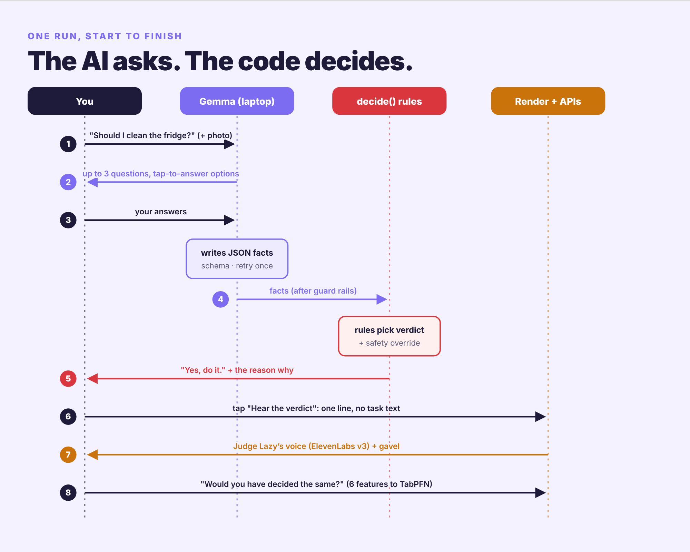
</p>

**The model never picks the verdict.** Gemma 3 4B (via Ollama, on your machine) does three jobs:

1. **Photo:** transcribes only what's visible, and you can correct it.
2. **Questions:** decides what to ask, up to 3 questions with tap options.
3. **Facts:** extracts schema-constrained JSON (Ollama `format`): category, deadline, if_skipped, consequence, affects_others, can_be_undone_later, effort_minutes, lazy_minimum, lazy_minimum_minutes, confidence, one_line_reason.

Then `decide()` in [`public/decide.js`](public/decide.js), about 200 lines of plain JavaScript, picks the verdict:

<p align="center">
  
</p>

<details>
<summary><b>The rules as text</b></summary>

- Confidence below 0.5 → **Not sure yet**.
- `severe` → **Yes**. `serious` → **Later** if the deadline is more than 3 days away, otherwise **Yes**.
- `annoying` → **Lazy minimum** if there's a real one (≥ 1 min and cheaper than the full task), else **Later** if there's time or it can be fixed later, else **Yes**.
- `minor` → **Skip**, unless it affects someone else (then the minimum, later, or yes).
- `nothing` → **Skip**.
- **Safety:** health, money, legal/official and exam/graded tasks never get "skip". If the rules land on skip for one of those, it becomes the lazy minimum, later, or yes.

</details>

### Guard rails in code, not in the prompt

A 4B model is fast enough for a laptop, but it makes mistakes. These checks catch the ones we saw in testing:

- **Malformed JSON** → one retry that tells Gemma what was wrong, then a clear error.
- **Questions:** max 3, each needs 2–4 tap options, no two about the same fact. Gemma may only skip a question as "already answered" if it quotes the user's words, and the code checks that quote really is in what the user wrote. (In testing Gemma "quoted" things like *"They'll cut off the power"* that the user never said.)
- **Deadline:** if nothing the user said mentions a date or day, the app asks. If Gemma still returns a date nobody mentioned, it's dropped and the card says so.
- **Category safety net:** if the task's own words mention a bill, payment, doctor, exam, passport, etc., it's treated as protected even if Gemma filed it under "other". (In testing, Gemma filed "Pay the electricity bill" as "other".)
- **Profile relevance:** a 4B model uses whatever background it's given. In testing it told someone to skip the laundry because their attendance was high. So only "About me" sentences on the same topic as the task (study, money, work, health, social) reach the prompt.
- Every overrule is shown on the verdict card under "The app overruled Gemma".

The verdict card also shows **how long Gemma took on your laptop** (including model load time if any), the token counts, Gemma's generation speed in tokens/s, and the full table of extracted facts, plus Gemma's own "working" sentence and which rule fired.

## Where everything runs

<p align="center">
  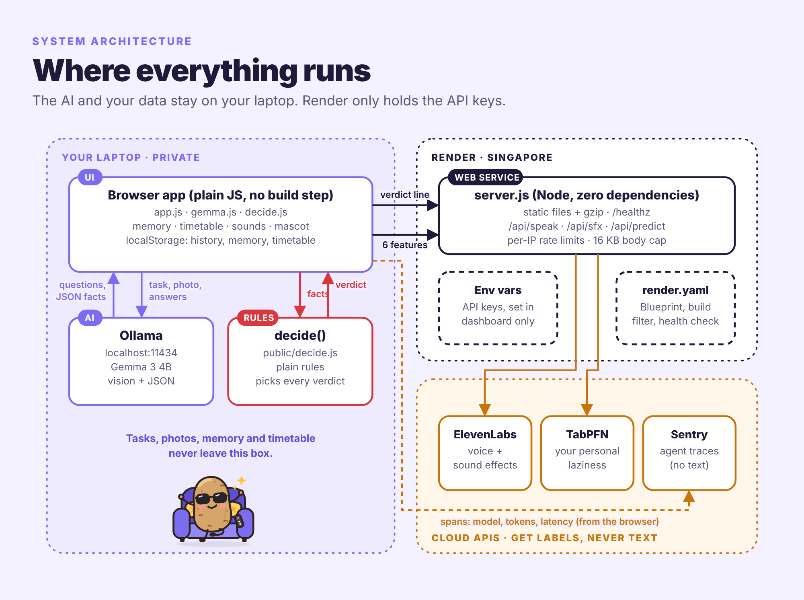
</p>

## Extras

All local, all in Settings.

### Lazy remembers you

After each verdict, one extra Gemma call (JSON schema) picks out up to **3 lasting facts** from what you typed and answered, e.g. *"College requires 75% attendance."* or *"Landlord charges a late fee after the 5th."*. One-off details (this bill, today's lecture, "within a week") are ignored. Code then checks each fact:

- it must share real words with what you actually typed, so Gemma can't "remember" things you never said;
- facts mentioning a one-off deadline are dropped;
- near-duplicates of a fact Lazy already knows are skipped, and only the newest 30 are kept.

The facts join your "About me" notes in every future prompt, passing through the same topic filter, so Lazy asks fewer questions. Settings → **What Lazy knows about you** lets you edit, delete or add facts. On the verdict screen, a small line says "Lazy learned: …" when something new is saved.

> **Privacy:** memory lives in `localStorage` and is only sent to Ollama on your computer. It never reaches the server, ElevenLabs, Sentry or TabPFN.

### Your timetable

Settings → **Your timetable**: add a photo or screenshot of your weekly timetable, or paste it as text.

- **Photo:** Gemma first transcribes it row by row, copying only what's visible and writing `[?]` for anything unreadable. If the transcript is a clean grid (days down the side, time slots across the top, or the other way round), code converts it into entries exactly and instantly; afternoon slots written without AM/PM are handled. Anything else goes to a second Gemma call with a JSON schema: `[{day, start, end, title, type: class|lab|work|other}]`.
- **Checking:** every row is validated in code. Rows Gemma wasn't sure about, rows with unreadable times or an end before the start, and rows whose title isn't in what Gemma read get a **"check this"** badge instead of a guess.
- **Editing:** the result is an editable list (day, start, end, title, type), saved as you change it.

Today's and tomorrow's entries are then added to the prompt, **but only for schedule-ish tasks**: classes, work, a clock time, or a title from your timetable. So "Go to the 8 AM class tomorrow" stops getting "when is it?", and the laundry never hears about your DBMS lecture.

> **Privacy:** the timetable photo and entries stay in the browser (`localStorage`) and only go to Ollama on your computer.
>
> **Timing on the laptop this was built on:** reading a 7-day timetable photo took about 2 minutes (the transcription); a 22-entry timetable structured entirely by Gemma took over 4 minutes, which is why clean grids are converted in code.

### Plan my lazy day

Once a timetable is saved, a small "Plan my lazy day" link appears under the main button. It takes today's timetable entries and makes **one batched Gemma call** that writes down the same facts as the normal flow for every item. Code sets each deadline to today and applies the safety keywords, and items Gemma skips become "Not sure yet". The **existing `decide()`** then rules on each item.

The list is grouped as Must do · Lazy minimum (with the minimum and its minutes) · Skip · Later · Not sure, with Lazy at the top in the mood of the day's most common verdict and the "minutes saved today" from Gemma's effort estimates. Tap an item to run the normal question → verdict flow for it. Same privacy as everything else: only the local Gemma sees the timetable.

### Lazy reads the questions aloud

When the ElevenLabs key is set, Lazy reads each question card aloud through the same `/api/speak` route, so asking feels like a conversation. The server accepts either a verdict line or a short question (one sentence, at most 140 characters, ending in "?", no links), still behind its own rate limit, so it isn't a general text-to-speech proxy. Settings → **Voice** has the off switch. Only the question text is sent; it can paraphrase your task.

**Not shipped: the mic.** Local speech-to-text with Whisper (transformers.js) was planned but couldn't be built and verified before the deadline, so it isn't included. Nothing uses the browser's built-in speech recognition, which would send your audio to Google.

### Funny sounds

[`public/sounds.js`](public/sounds.js) makes tiny sounds with the Web Audio API (no audio files, nothing downloaded): a *tap* on chips and answers, a *pop* on main buttons, a "hmm-mm" while Gemma thinks, a *flump* as Lazy lands on the couch, then the verdict's own sound 300 ms later (a snore for skip, a coffee slurp for the minimum, tick-tock for later, a panicked *boing* for "do it", a rising "huh?" for not sure), a *ding* after "Would you have decided the same?", and a sparkle when Lazy learns something. They're quiet, never block anything, and stay silent while Lazy's ElevenLabs voice is speaking. The speaker button in the header turns them off, and the choice is remembered.

## Partner technologies

Exactly what each one does here, and nothing more.

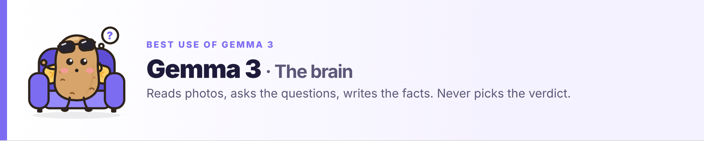

**Gemma 3 4B** (open weights) via **Ollama** runs on the user's laptop. It transcribes photos, decides the follow-up questions, and extracts the facts as schema-constrained JSON. It never chooses the verdict.

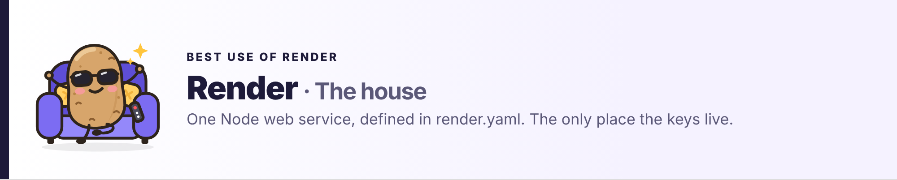

**Render** hosts `server.js` as one Node web service from the [`render.yaml`](render.yaml) Blueprint:

- Singapore region (closest to India), `npm ci` / `node server.js`, health check at `/healthz`.
- A `buildFilter`, so README-only pushes don't redeploy.
- API keys as dashboard-only environment variables.
- The server gzips static files, rate-limits `/api/*` per IP, and reads Render's `RENDER_GIT_COMMIT` so the footer shows which commit is live.

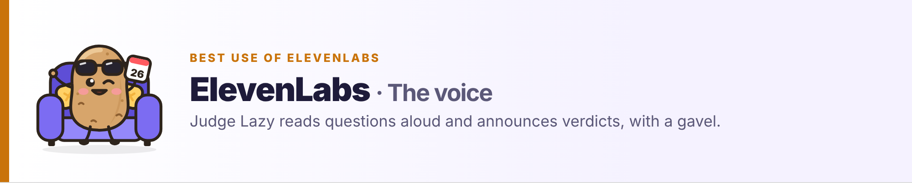

**ElevenLabs** is Judge Lazy's voice.

- `POST /api/speak` performs the one-line verdict with **`eleven_v3` audio tags** that the server adds per verdict, e.g. `[sighs] Skip it. … [laughs] Court is adjourned.` or `[clears throat] Yes, do it. …`. It falls back to the plain `eleven_multilingual_v2` voice if v3 fails.
- **Sound effects** (`/api/sfx/gavel`, `/api/sfx/snore`) come from the ElevenLabs sound-generation API using fixed prompts, generated once per server process and cached: the gavel bangs before the verdict, and poking Lazy snores.
- Only verdict-shaped lines and short questions are voiced (no free TTS proxy), with a tighter rate limit and browser-side caching. Without a key, the "Hear the verdict" button doesn't appear.

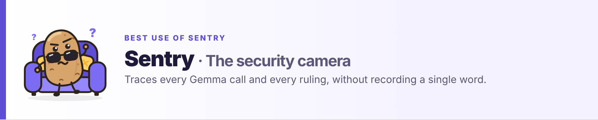

**Sentry** does agent tracing. When `SENTRY_DSN` is set, the browser loads the Sentry SDK from its CDN (pinned version + SRI hash) using the DSN from `/api/config`.

<p align="center">
  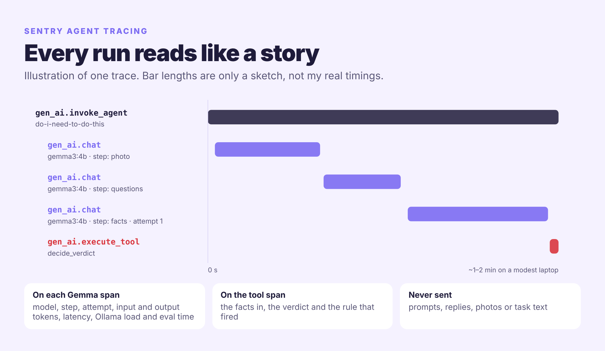
</p>

- Each phase is one trace: a `gen_ai.invoke_agent` root span (with the verdict and the rule that fired) containing one `gen_ai.chat` span per Gemma call.
- Each Gemma span carries `gen_ai.request.model`, `step` (photo / questions / facts), `attempt`, `gen_ai.usage.input_tokens` / `output_tokens` (Ollama's `prompt_eval_count` / `eval_count`), `latency_ms` and Ollama's own load/eval timings.
- The rules themselves are a `gen_ai.execute_tool` span (`execute_tool decide_verdict`) with the structured facts as `gen_ai.tool.input` and the verdict + rule as `gen_ai.tool.output`, so a trace reads agent → Gemma → Gemma → rules. The TabPFN prediction and the ElevenLabs voice get their own spans.
- Malformed-JSON replies are captured as errors tagged with step and attempt. When you disagree with the court, a **feedback** event records the two verdict keys and the rule id, the best signal for tuning the rules.
- **No prompts, replies, photos or task text are sent**: messages are cut before any quoted text, only the reply's length is attached, and console/click breadcrumbs are dropped.

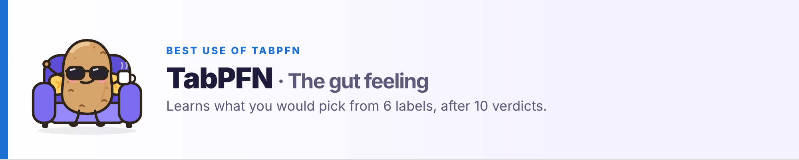

**TabPFN** (Prior Labs) learns your personal laziness.

- Once you've tapped what you actually did on at least 10 verdicts (with at least two different choices), `POST /api/predict` sends **only** six features per labelled verdict (category, consequence, days to deadline, affects others, can be fixed later, effort minutes) plus your own choice, and the same six features for the current task.
- The server checks every value against the fixed enums and number ranges, so free text is rejected with a 400. It then runs the TabPFN REST flow (upload CSVs, fit, predict with `output_type: "probas"`) with `TABPFN_TOKEN`.
- The card shows "Based on your past choices, you'd probably pick: X (NN%)" with a bar for every verdict's probability, and says whether your past self agrees with the court. History shows how many more answers Lazy needs before it can learn.
- The rules' verdict stays the one that counts. The safety rules are never replaced.

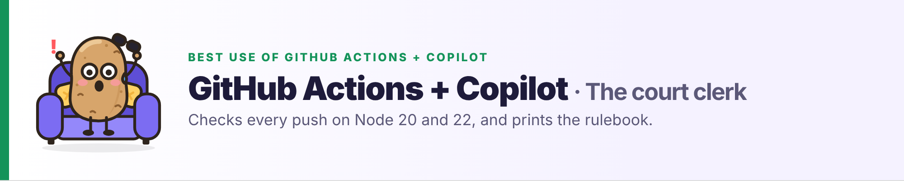

**GitHub Actions + Copilot** are the court clerk.

- Every push runs `node --check`, the tests on Node 20 and 22, and a server smoke test (health, static files, gzip, the 503 fallback when a key is missing, and a path-traversal check).
- The job summary prints the test counts and a live table of what `decide()` rules for each consequence × situation.
- `main` deploys `public/` to GitHub Pages.
- [`.github/copilot-instructions.md`](.github/copilot-instructions.md) gives contributors' Copilot the project's hard rules (rules pick verdicts, privacy, safety, no invented numbers), and Dependabot keeps the Actions current.

## Privacy

- Your task text, context, photo and "About me" profile go **only** from your browser to Ollama on `localhost`.
- The page loads the Inter font from Google Fonts (falls back to the system font if it's blocked).
- History and profile are stored in your browser's `localStorage`. Export them as CSV from **History**.
- The optional server ([`server.js`](server.js)) holds API keys in environment variables. It never receives photos (request bodies are capped at 16 KB) and never sees your profile.
- For the TabPFN prediction, only six numeric/categorical features per verdict and your own verdict labels are sent; the server rejects anything else.
- When you tap "Hear the verdict", only the one-line verdict is sent (hover the button to see the exact line). That line can include Gemma's one-sentence summary, which may paraphrase your task.

## Run it

### 1. Ollama + Gemma

```bash
# install from https://ollama.com/download, then:
ollama pull gemma3:4b
```

Ollama accepts requests from `localhost` pages by default. To use the hosted copy at [raga-v.github.io/do-i-need-to-do-this](https://raga-v.github.io/do-i-need-to-do-this/) (or your own Render deploy), allow that origin:

```bash
# macOS / Linux
OLLAMA_ORIGINS="https://raga-v.github.io" ollama serve
# Windows PowerShell (quit the Ollama tray app first)
$env:OLLAMA_ORIGINS="https://raga-v.github.io"; ollama serve
```

Settings → **Your local AI** shows the exact command for whatever site you're on, and can test the connection. Chrome may ask permission to reach devices on your local network; allow it. Safari blocks https pages from calling `http://localhost`, so use Chrome, Edge or Firefox there, or run locally.

### 2. The app

```bash
npm ci
npm start            # http://localhost:3000
```

No build step: `public/` is plain HTML, CSS and ES modules. Any static server works too; only the optional voice/prediction features need `server.js`.

### 3. Switch on the partner features (optional)

Voice, sound effects, tracing and the personal prediction run through `server.js` and need API keys. Locally, put them in a `.env` file (git-ignored; the server reads it on start):

```bash
cp .env.example .env    # then fill in the keys you have
npm start               # the startup line says which keys are set
```

| Key | Switches on |
|---|---|
| `ELEVENLABS_API_KEY` | "Hear the verdict", the gavel, the snore, questions read aloud |
| `SENTRY_DSN` | Tracing of every Gemma call and rule decision |
| `TABPFN_TOKEN` | "Based on your past choices…" after 10 answered verdicts |

Settings → **Powered by** shows which ones are on. On Render, set the same keys in the dashboard.

### Tests

```bash
npm run check        # node --check on every JS file
npm test             # decide() rules, Gemma client (mocked Ollama), memory, timetable, TabPFN, server
npm run try -- "Pay the electricity bill"   # the real pipeline against local Ollama, in the terminal
```

## Deploy

- **GitHub Actions** ([`.github/workflows/deploy.yml`](.github/workflows/deploy.yml)): every push runs `node --check`, the tests and a server smoke test; on `main` it then deploys `public/` to GitHub Pages. The static copy works fully with your local Ollama; server features stay hidden there.
- **Render** ([`render.yaml`](render.yaml)): a Blueprint for one Node web service (`npm ci`, `node server.js`, health check `/healthz`). Set `ELEVENLABS_API_KEY`, `SENTRY_DSN` and `TABPFN_TOKEN` in the Render dashboard; each feature switches itself off when its key is missing. `/api/*` routes are rate limited per IP.

## Honest limits

- **Gemma 3 4B is small.** It can misread messy or low-light photos and mix up rows in a timetable. That's why the photo transcription is shown and editable before it's used. Its arithmetic is shaky too: in one test it wrote that missing one class takes 88% attendance "below 75% (88% − 1 class = 87%)", though it still rated the consequence `minor`. The rules only read the structured fields, and the card shows Gemma's working so you can spot this.
- **It's slow on modest laptops.** On the laptop this was built on, a full run (photo + questions + facts) took about 1–2 minutes, and loading the model the first time took about 40 seconds. The card always shows the real time.
- The effort and "lazy payoff" minutes are Gemma's own estimates, not measurements.
- Safety keywords are English-only and simple; they catch the common cases, not all of them.
- **TabPFN learns from a tiny personal dataset** (10+ rows from one person), so its guess is a hint about your habits, not a reliable model. With few or very similar rows it mostly echoes your most common choice.
- **What's been tested live:** the Gemma pipeline against real Ollama with `gemma3:4b` (text and photo). With real keys: ElevenLabs voice through `eleven_v3` with the audio tags and the gavel sound effect, the full TabPFN REST flow (upload, fit, predict), and Sentry ingest accepting the app's traces. CI runs on every push; the Render deploy runs once the Blueprint is created. How each ElevenLabs audio tag sounds depends on the voice.

## Project layout

```
public/            the app (served as-is)
  index.html  style.css  app.js
  mascot.js        Lazy the couch potato: lazy(mood, size) and lazyFace(mood, size) → SVG
  icons.js         the small line icons used across the UI
  decide.js        the rules: the only place a verdict is chosen
  gemma.js         Ollama client, prompts, JSON schemas, guard rails
  features.js      the six TabPFN features (shared with the server's validator)
  sentry.js        optional Sentry tracing of the Gemma calls
server.js          optional Node server for Render (no dependencies)
tabpfn.js          server-side TabPFN REST client
test/              node --test suites
scripts/           syntax check, rules table for CI, terminal runner, mascot export for this README
docs/images/       README images (Lazy's moods come from scripts/export-mascot.mjs)
.github/           CI + Pages workflow, Copilot instructions, Dependabot
```

## License

MIT
